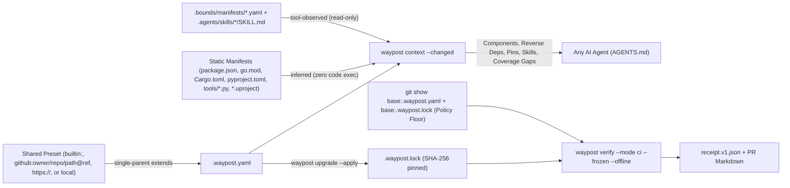

# waypost

**Agent-first repository orientation, inheritable policy, and deterministic verification — in one pure-Go binary.**

`waypost` replaces thousands of lines of vendored delivery scripts and bloated passive markdown rules with a clean, versioned, SHA-256-pinned control plane that works with **every modern and future AI coding agent** (Claude Code, Codex, Gemini, OpenCode, Cursor, Pi, and plain shell agents).

---

Waypost keeps repository policy in `.waypost.yaml` and pins inherited inputs in
`.waypost.lock`. Agents use the same component map and check scopes as verification.
Git supplies the history, and local verification state lives in Git metadata.

## Architecture



---

## 60-Second Quickstart

### Install

```bash
go install github.com/Farzin312/waypost/cmd/waypost@latest
```

Or build from source (pure Go, zero CGO):

```bash
git clone https://github.com/Farzin312/waypost.git
cd waypost
CGO_ENABLED=0 go build -o waypost ./cmd/waypost
```

### Initialize a repository

```bash
waypost init
# Optional GitHub Actions workflow and CLAUDE.md pointer
waypost init --ci --claude-md
```

`waypost init` safely inspects your manifests, lockfiles (`pnpm`/`bun`/`yarn`/`npm`), real `package.json` scripts, `.bounds/manifests/`, and `.agents/skills/` without executing repo code. It selects an exact 1.1.0 preset (`base`, `app-ts`, or `polyglot-native`), writes `.waypost.yaml` and `.waypost.lock`, and inserts a compact pointer block into `AGENTS.md` (preserving your existing instructions).
Starter checks use declared package scripts, Go and Cargo manifests, and Python
test and Ruff configuration. A complete source scan seeds `enforce` when clean
or `ratchet` with a tracked baseline when it finds existing violations.
`--ci` generates a read-only workflow with detected branch filters and runtime
setup. It installs the Waypost release, runs committed preflight before dependency
installation, and preserves an existing workflow unless `--force` is supplied.

### Orient any AI agent ("what builds on what") & enforce architecture boundaries

```bash
waypost context --changed
waypost graph --changed --check-boundaries
waypost graph --mermaid
waypost spec --component api --history
waypost history --trust-only --format markdown
```

`waypost graph` replaces legacy external boundary tools (like `.bounds` + SQLite cache DBs + generated symbol manifests) with a **built-in, pure-Go polyglot static import engine** (TypeScript/JS with `tsconfig.json` `paths` & `baseUrl`, Go `go/parser` AST, Python, and Rust):

- Computes **live observed component edges**, **high-fan-in hubs**, **file-level + component-level blast radius**, and **circular import cycles with exact `file:line` witnesses** — in milliseconds, with zero cache DBs and zero manifest churn.
- Enforces declarative `boundaries:` rules (`no_cycles`, `enforce_declared_deps`, `allow_depends_on`, `deny_depends_on`, `public_entrypoints`, `ignore_paths`) inside `waypost verify` as a built-in `waypost-boundaries` check protected by the CI base-branch policy floor.
- Migrates legacy `.bounds/` repositories cleanly in one command: `waypost init --from-bounds`.

For an existing repository with boundary debt, enable `boundaries.enabled: true` and set
`boundaries.mode: ratchet`. Run `waypost graph --update-baseline` to seed and review
`.waypost.baseline.json`, or set `boundaries.baseline` to a custom repository-relative path.
CI fails on new violations and uses the base branch's baseline to reject PRs that expand it.
Fingerprints survive line-number changes. Use `waypost sync --apply` after fixing old
violations to shrink the baseline or switch to `enforce` after a complete clean
scan. A smaller cycle can retain the allowance of a single old cycle if every
member and directed edge is already covered.

Changed context shows touched components, reverse impact, applicable invariants,
selected checks, and recent commit subjects. Use `--recent 0` to omit history.
Local verification records its outcome and exact worktree fingerprint in
`$(git rev-parse --git-dir)/waypost/last-receipt-<prefixhash>.json`.
Freshness includes the worktree, Git index, comparison base, and selected checks.
Changed context also reports which production components lack touched tests.

`spec` distinguishes executable entrypoints, public imports, declared dependencies,
observed imports, and discovered tests. Add `reason` and `verified_by` to connect an
invariant to checks and tracked test files. Use `--ref` to read a committed snapshot.
`history` follows first parents by default. Use `--all-parents` for side branches,
`--limit 0` for the full stream, or `--cursor` to continue a page. Both commands
read static inputs and can emit text, Markdown, or JSON. History comparisons
include bounded samples and omitted counts. `--component` scopes the comparison
to that component. `spec --history` requires a positive limit.

### Keep the repository contract current

```bash
waypost sync               # Preview drift
waypost sync --check       # Fail on actionable drift
waypost sync --check --offline --ref HEAD  # Inspect committed inputs in CI
waypost sync --apply       # Apply safe updates and refresh the frozen lock
```

Sync discovers unowned source directories, stale components, changed package pins,
and missing check scripts. Apply preserves YAML comments and updates the contract
and baseline in one recoverable publication. Broken proof links and unsafe
baseline files block sync. Unwired scripts and expired `crutch` rules are
advisory. Sync resolves workspace-qualified npm commands without running them. Review
authorization changes with `waypost upgrade` and publish them explicitly with
`waypost upgrade --apply`.

`waypost pins` checks typed npm manifest sources and relevant lock or vendored
artifact integrity offline. Compare explicitly supplied snapshots with
`waypost pins --repo ../producer@main --repo .@HEAD`. A consumer that matches its
declared release can report `behind` when a newer producer is available.

### Verify deterministically (local or CI)

```bash
# Developer / agent pre-claim check
waypost verify

# Authoritative CI gate with base-branch policy floor & SHA-256-verified frozen lockfile
waypost verify --mode ci --frozen --base "$EVENT_BASE_SHA" \
  --receipt .waypost/receipt.v1.json \
  --markdown .waypost/receipt.md

# Air-gapped / pre-warmed cache CI (after restoring ~/.cache/waypost/presets)
waypost verify --mode ci --frozen --offline --base "$EVENT_BASE_SHA"
```

CI requires a verified event base even with `--all`. Set it from the pull
request base SHA or the push's previous SHA. The target tip supplies the policy
floor and the merge base supplies change attribution. Verification runs both
definitions when a required command changes. CI and escalated runs use
`command`. Scoped local verification can use `local_command` with a private
NUL-delimited `WAYPOST_CHANGED_FILES_FILE`. For production edits, explicit
`node --test <files>` and `npm run <jest-script> -- --runTestsByPath <files>`
commands with existing test paths are eligible for the local lane. Other
selectors use the full command for production edits. A local selector can
exit with `WAYPOST_NO_TESTS_EXIT_CODE` (5) to request full verification. The
receipt records the final command and lane. Set `serial: false` on independent
checks to allow concurrency and use `--jobs 1` to run serially.

### Inherit & upgrade shared presets across all repositories

Builtins have exact versions. Frozen floating references keep the versions
recorded in their locks. CI and historical reads resolve file parents inside
the selected repository snapshot.

```bash
waypost upgrade --to builtin:app-ts@1.1.0 --dry-run
waypost upgrade --to builtin:app-ts@1.1.0 --apply
```

Remote presets are cached content-addressed under `$WAYPOST_CACHE_DIR` (or `~/.cache/waypost/presets/<sha256>.yaml`), strictly verified against `.waypost.lock` in `--mode ci`, `--frozen`, or `--offline`, and prohibited from extending local filesystem paths.

---

## Key Guarantees

- **Fail-Closed Policy Authority (`--mode ci`):** Enforces policy from the verified target commit so a PR cannot silently delete or weaken required checks or spoof remote preset pins. Evaluates **both sides of renames and deletions**, ignores `.waypost.local.yaml` in CI, and escalates unmapped paths or trust-boundary edits to the full repo gate.
- **Honest 4-State Verification:** Strict `PASS | FAIL | WARN | SKIP`. Unavailable required binaries (`requires_bin`) fail closed as `FAIL`, never `PASS` or `SKIP`. Check output is memory-bounded (64 KiB head+tail capture), preserves trailing failure traces, and scrubs common secrets before writing `receipt.v1.json`.
- **Inheritable & Composable Without Vendoring:** Single-parent `extends` rejects cycles, duplicate IDs, and remote-to-local escapes. Native read-only ingestion for `.bounds/manifests/*.yaml` and `.agents/skills/*/SKILL.md` works out of the box, while active external providers remain behind an explicit `authorized: true` gate pinned in `.waypost.lock`.
- **Built to Grow With Newer AI:** Rules and skills distinguish `kind: invariant` from `kind: crutch` so model-era scaffolding can be pruned cleanly across repositories as frontier models improve.
- **Pure Go Harness, Polyglot Target Apps:** `waypost` itself is 100% pure Go (`CGO_ENABLED=0`) for zero-runtime-friction distribution across macOS, Linux, and Windows (`cmd /C` on Windows, `sh -c` on Unix), while supporting TypeScript, Go, Rust, Python, and Unreal C++/native repositories.

---

## GitHub Action

Pin `Farzin312/waypost/action` to the full release commit SHA. Use a full
checkout with persisted credentials disabled. The composite Action builds
its own source using the Go version pinned in `go.mod` and runs offline sync
before verification. It derives the base from the GitHub event and publishes
the receipt path and failing stage under the runner's temporary directory.
Use `allow-bootstrap: "true"` for an explicitly authorized first adoption
whose target has no Waypost policy. An explicit base alias on a PR or push
must resolve to the event SHA. The verifier toolchain is selected for the
Action build without changing the caller's PATH.

When changing required checks on adoption or upgrade, provision dependencies
and services for both the old and new commands in the same workflow change.
Run committed preflight before installs that execute lifecycle scripts.
Provision any database services and subproject dependencies used by new
required checks. Run installs such as `npm ci` after committed preflight so
lifecycle scripts such as `prepare` run after policy validation.

---

## Documentation & Schemas

- [Architecture & Threat Model](docs/ARCHITECTURE.md)
- [Component Map & Real-World Examples](docs/COMPONENT_MAP.md)
- [Growing With Newer AI (`invariant` vs `crutch`)](docs/EVOLUTION.md)
- [Packaging External Tools & Skills](docs/PACKAGING.md)
- JSON Schemas: [waypost.v1](schemas/waypost.v1.schema.json) · [lock.v1](schemas/lock.v1.schema.json) · [receipt.v1](schemas/receipt.v1.schema.json) · [spec.v1](schemas/spec.v1.schema.json) · [history.v1](schemas/history.v1.schema.json) · [pins.v1](schemas/pins.v1.schema.json)
- Worked Examples: [TypeScript Mobile App](examples/app-ts/.waypost.yaml) · [Unreal C++ / Python Polyglot](examples/polyglot-native/.waypost.yaml)

## License

MIT — see [LICENSE](LICENSE).
