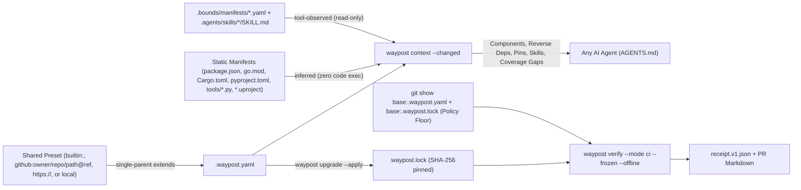

# waypost

**Agent-first repository orientation, inheritable policy, and deterministic verification — in one pure-Go binary.**

`waypost` replaces thousands of lines of vendored delivery scripts and bloated passive markdown rules with a clean, versioned, SHA-256-pinned control plane that works with **every modern and future AI coding agent** (Claude Code, Codex, Gemini, OpenCode, Cursor, Pi, and plain shell agents).

---

## Why Waypost?

Traditional per-repo "AI delivery systems" break down as projects scale:

- **Copy-paste drift:** Vendoring 4,000+ lines of workflow scripts and markdown templates into every repo makes upgrades painful and inconsistent.
- **Bookkeeping churn:** 20–40% of git commits become pure task/status/markdown bookkeeping instead of product engineering.
- **Passive markdown failure:** Long `AGENTS.md` instructions decay under long context; only deterministic checks and CI policy floors actually hold.
- **Blind agents:** Agents waste tokens grepping repositories without knowing *"what builds on what"*, which cross-repo contracts are pinned, which AAIF skills exist locally, or which files sit inside trust boundaries.

`waypost` fixes all four with **6 focused commands** (`init`, `context`, `graph`, `verify`, `upgrade`, `version`), **1 config file (`.waypost.yaml`)**, **1 frozen lockfile (`.waypost.lock`)**, and **1 provenance-bound verification receipt (`receipt.v1.json`)**.

---

## Architecture



---

## 60-Second Quickstart

### Install

```bash
go install github.com/Farzin312/waypost/cmd/waypost@latest
```

Or build from source (pure Go, zero CGO):

```bash
git clone https://github.com/Farzin312/waypost.git
cd waypost
CGO_ENABLED=0 go build -o waypost ./cmd/waypost
```

### Initialize a repository

```bash
waypost init
# Optional: also create a 1-line CLAUDE.md -> @AGENTS.md pointer if absent
waypost init --claude-md
```

`waypost init` safely inspects your manifests, lockfiles (`pnpm`/`bun`/`yarn`/`npm`), real `package.json` scripts, `.bounds/manifests/`, and `.agents/skills/` without executing repo code. It selects a fitting preset (`base`, `app-ts`, or `polyglot-native`), writes `.waypost.yaml` and `.waypost.lock`, and inserts a compact pointer block into `AGENTS.md` (preserving your existing instructions).

### Orient any AI agent ("what builds on what") & enforce architecture boundaries

```bash
waypost context --changed
waypost graph --changed --check-boundaries
waypost graph --mermaid
```

`waypost graph` replaces legacy external boundary tools (like `.bounds` + SQLite cache DBs + generated symbol manifests) with a **built-in, pure-Go polyglot static import engine** (TypeScript/JS with `tsconfig.json` `paths` & `baseUrl`, Go `go/parser` AST, Python, and Rust):

- Computes **live observed component edges**, **high-fan-in hubs**, **file-level + component-level blast radius**, and **circular import cycles with exact `file:line` witnesses** — in milliseconds, with zero cache DBs and zero manifest churn.
- Enforces declarative `boundaries:` rules (`no_cycles`, `enforce_declared_deps`, `allow_depends_on`, `deny_depends_on`, `public_entrypoints`, `ignore_paths`) inside `waypost verify` as a built-in `waypost-boundaries` check protected by the CI base-branch policy floor.
- Migrates legacy `.bounds/` repositories cleanly in one command: `waypost init --from-bounds`.

Reports:
- **Components** with explicit provenance (`declared | inferred | tool-observed`), `depends_on`, reverse `depended_by` (*what builds on this component*), and cycle warnings
- **Cross-repo pins** (`producer`, `artifact`, `consumer`, `compatibility_check`)
- **Ecosystem & local AAIF skills** (`AGENTS.md`, `CLAUDE.md`, `.bounds`, `gitleaks`, `.agents/skills/*/SKILL.md`, and duplicate `.claude/skills/` warnings)
- **Rules** classified as `invariant` (permanent) vs `crutch` (model-era guidance eligible for pruning)
- **Honest gaps:** explicit `unmapped_paths` and `coverage_gaps`

### Verify deterministically (local or CI)

```bash
# Developer / agent pre-claim check
waypost verify

# Authoritative CI gate with base-branch policy floor & SHA-256-verified frozen lockfile
waypost verify --mode ci --frozen --base origin/main \
  --receipt .waypost/receipt.v1.json \
  --markdown .waypost/receipt.md

# Air-gapped / pre-warmed cache CI (after restoring ~/.cache/waypost/presets)
waypost verify --mode ci --frozen --offline --base origin/main
```

### Inherit & upgrade shared presets across all repositories

Supports built-in (`builtin:app-ts@1.0.0`), local relative paths (`../org-presets/v1.1.yaml`), and SHA-256-pinned remote presets (`github:owner/repo/presets/app-ts.yaml@v1.2.0` or `https://...`):

```bash
# Preview exact rule/check diffs & explicit permission-change warnings
waypost upgrade --target github:Farzin312/waypost/internal/presets/app-ts.yaml@v0.1.0 --dry-run

# Apply atomically & pin SHA-256 in .waypost.lock (git revert is always a clean rollback)
waypost upgrade --target github:Farzin312/waypost/internal/presets/app-ts.yaml@v0.1.0 --apply
```

Remote presets are cached content-addressed under `$WAYPOST_CACHE_DIR` (or `~/.cache/waypost/presets/<sha256>.yaml`), strictly verified against `.waypost.lock` in `--mode ci`, `--frozen`, or `--offline`, and prohibited from extending local filesystem paths.

---

## Key Guarantees

- **Fail-Closed Policy Authority (`--mode ci`):** Enforces a **base-branch policy floor** (`git show <base>:.waypost.yaml` + `base:.waypost.lock`) so a PR cannot silently delete or weaken required checks or spoof remote preset pins. Evaluates **both sides of renames and deletions**, ignores `.waypost.local.yaml` in CI, and escalates unmapped paths or trust-boundary edits to the full repo gate.
- **Honest 4-State Verification:** Strict `PASS | FAIL | WARN | SKIP`. Unavailable required binaries (`requires_bin`) fail closed as `FAIL`, never `PASS` or `SKIP`. Check output is memory-bounded (64 KiB head+tail capture), preserves trailing failure traces, and scrubs common secrets before writing `receipt.v1.json`.
- **Inheritable & Composable Without Vendoring:** Single-parent `extends` rejects cycles, duplicate IDs, and remote-to-local escapes. Native read-only ingestion for `.bounds/manifests/*.yaml` and `.agents/skills/*/SKILL.md` works out of the box, while active external providers remain behind an explicit `authorized: true` gate pinned in `.waypost.lock`.
- **Built to Grow With Newer AI:** Rules and skills distinguish `kind: invariant` from `kind: crutch` so model-era scaffolding can be pruned cleanly across repositories as frontier models improve.
- **Pure Go Harness, Polyglot Target Apps:** `waypost` itself is 100% pure Go (`CGO_ENABLED=0`) for zero-runtime-friction distribution across macOS, Linux, and Windows (`cmd /C` on Windows, `sh -c` on Unix), while supporting TypeScript, Go, Rust, Python, and Unreal C++/native repositories.

---

## GitHub Action

Use the included composite action in `.github/workflows/ci.yml`:

```yaml
- uses: actions/checkout@v4
  with:
    fetch-depth: 0
- uses: Farzin312/waypost/action@main
  with:
    frozen: "true"
```

---

## Documentation & Schemas

- [Architecture & Threat Model](docs/ARCHITECTURE.md)
- [Component Map & Real-World Examples](docs/COMPONENT_MAP.md)
- [Growing With Newer AI (`invariant` vs `crutch`)](docs/EVOLUTION.md)
- [Packaging External Tools & Skills](docs/PACKAGING.md)
- JSON Schemas: [waypost.v1](schemas/waypost.v1.schema.json) · [lock.v1](schemas/lock.v1.schema.json) · [receipt.v1](schemas/receipt.v1.schema.json)
- Worked Examples: [TypeScript Mobile App](examples/app-ts/.waypost.yaml) · [Unreal C++ / Python Polyglot](examples/polyglot-native/.waypost.yaml)

## License

MIT — see [LICENSE](LICENSE).
